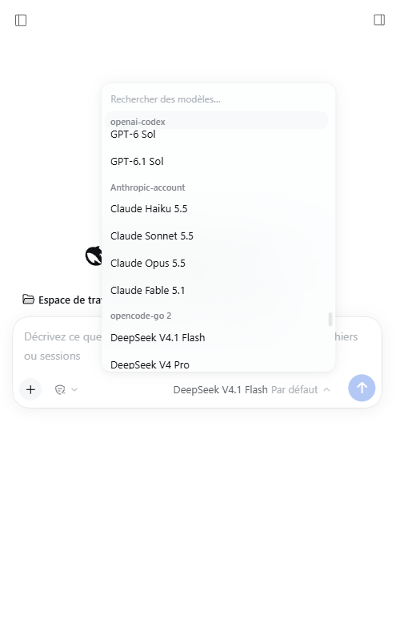
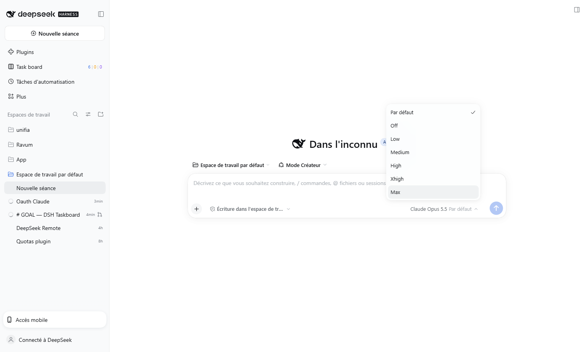

# dsh-anthropic-account

[](https://github.com/Rwanbt/dsh-anthropic-account/actions/workflows/ci.yml)
[](https://github.com/Rwanbt/dsh-anthropic-account/releases)
[](LICENSE)

A [DeepSeek Harness](https://github.com/deepseek-ai/deepseek-harness) plugin that adds an
**Anthropic-account** model provider powered by your **Claude Pro/Max subscription**, repairs
the **Codex** OAuth connection — both by reusing the credentials the Claude Code and Codex CLIs
already keep on your machine — and adds a **one-click account connection panel** to
**Settings → Models**.



No browser round trip, no protocol reimplementation: the plugin hands the Harness a subscription
token through its credential plane, and the bundled pi-ai adapter does the rest.

## What you get

- **A provider in Settings → Models** named `Anthropic-account`, with a credential reference that
  is always a live Claude subscription token.
- **A model list that follows your account**: read from `GET /v1/models` at start and every
  6 hours, reduced to the **latest generation of each family** (Opus, Sonnet, Haiku, Fable), with
  the real context window, output cap and image support reported by the endpoint.
- **A working Effort setting** on every model: the endpoint's advertised reasoning levels become
  the model's `reasoningEfforts`, so the composer offers Low / Medium / High / Xhigh / Max (plus
  Off only where the endpoint says the model accepts disabled thinking) instead of hiding the
  control.
- **Working compaction.** `/compact` and automatic condensation summarize through a request that
  names no reasoning effort; the profile is written so that request stays valid on every model
  (see [How it works](#how-it-works), step 4).
- **A repaired Codex connection**: `~/.codex/auth.json` is converted into the
  `llm-pi-ai/openai-codex` credential record the shipped `openai-codex` provider already reads.
- **Account connections in Settings → Models**: two cards start the official Claude Code and
  Codex sign-in flows, show the authorize URL, display the ChatGPT one-time code, accept the
  authorization code the Claude page prints, and report the result — no terminal needed.
- Tokens stay in the credential plane; nothing secret is ever written to configuration.



## How it works

1. **Route.** The plugin provisions a hand-declared `llm-pi-ai` route
   (`api: anthropic-messages`, endpoint `https://api.anthropic.com`, credential reference
   `ANTHROPIC_ACCOUNT_OAUTH`) through the same settings plane the Models page writes.
2. **Token.** It reads the Claude Code credential store, mirrors the `sk-ant-oat…` access token
   into that reference, and refreshes it shortly before expiry (writing the rotated token back so
   Claude Code stays signed in).
3. **Models.** `GET /v1/models` with the grant returns each model's id, display name, `line`,
   `created_at`, `max_input_tokens`, `max_tokens`, image capability, lifecycle and its reasoning
   capabilities. The sync keeps `modelsPerFamily` generations per family, skips
   `deprecated`/`retired`, and only writes when the list changed.
4. **Reasoning.** The same capabilities say which effort levels a model accepts, whether it
   thinks adaptively, and whether it can stop thinking at all. The sync writes the levels as the
   profile's `reasoningEfforts`, plus `compat.forceAdaptiveThinking` for adaptive-only models (the
   wire shape they require — `thinking: { type: 'adaptive', effort }`, not a token budget). A
   hand-declared route inherits no reasoning from an installed catalog entry, so without this step
   the composer offers no effort setting at all.
   `off` is declared **only** when `capabilities.thinking.types.disabled.supported` is true. It is
   translated into `thinking: { type: 'disabled' }` for any request that names no effort, and
   current Claude models reject that shape:

   ```
   400 invalid_request_error: "thinking.type.disabled" is not supported for this model.
   Use "thinking.type.adaptive" and "output_config.effort" to control thinking behavior.
   ```

   That is not only a picker problem: the Harness compaction backend summarizes through a plain
   `llm.stream()` call that selects no effort, so advertising `off` broke `/compact` and every
   automatic condensation on those models. Leaving `off` undeclared makes the request omit
   `thinking` entirely, which the endpoint accepts (the model default applies).
5. **Codex.** The Codex grant is imported once; pi-ai refreshes it from then on.
6. **In-app connection.** The settings panel starts `claude auth login` or
   `codex login --device-auth` through the Harness subprocess service, reads the URL (and the
   Codex one-time code) from the CLI output, and writes the authorization code you paste back to
   the CLI's stdin. A successful exit runs the same mirror/import steps as the bootstrap, so the
   provider and the quota panel update without a restart.

The bundled pi-ai adapter detects an `sk-ant-oat…` token and switches to the subscription wire
shape on its own (Bearer auth, Claude Code identity headers, `claude-code-20250219` and
`oauth-2025-04-20` betas, Claude Code system identity and tool names), so this plugin contains no
Anthropic protocol code.

## Requirements

- DeepSeek Harness `0.2.2` or newer (tested against `0.2.2-rc.1`), with the `llm-pi-ai`,
  `settings` and `credentials` plugins mounted (they are part of the shipped base/web bundles).
- **Claude Code** installed and available on `PATH`, to sign in and keep the session refreshed.
- Node.js 20+ (the Harness bundles its own runtime).
- Optional: the **Codex CLI** on `PATH`, for the Codex connection and repair.

## Install

Clone the repository somewhere permanent, then install the directory as a Harness bundle:

```bash
git clone https://github.com/Rwanbt/dsh-anthropic-account.git
```

- **From the Plugins page** — install the cloned directory as a local bundle.
- **From an agent session** — `plugin_manager` with `action: install_bundle` and the absolute
  path of the cloned directory as `target`.

The plugin provisions its route as soon as it loads; no further step is needed. Restart the
Harness after cloning to a new path.

To remove it again, delete the `anthropic-account` provider row on the Models page and remove the
bundle. The credential reference and the rotated Claude Code tokens stay valid, so nothing breaks.

## Where the credentials come from

| Platform | Claude Code store | Codex store |
|---|---|---|
| Windows | `%USERPROFILE%\.claude\.credentials.json` | `%USERPROFILE%\.codex\auth.json` |
| Linux | `~/.claude/.credentials.json` (`$CLAUDE_CONFIG_DIR` honoured) | `~/.codex/auth.json` |
| macOS | login Keychain: `Claude Code-credentials` (and `Claude Code-credentials-<hash8>` per config dir), falling back to `~/.claude/.credentials.json` | `~/.codex/auth.json` |

The status file records which source was used (`claude.source`).

## Sign in from Settings → Models

The **Account connections** block at the bottom of the page offers one card per account:

- **Claude (Pro/Max)** — *Sign in* starts `claude auth login` and opens the browser. After
  authorizing on claude.com, copy the code the page shows, paste it into the card, and validate.
  The card turns *Connected* with the subscription plan once the token is mirrored.
- **ChatGPT (Codex)** — *Sign in* starts `codex login --device-auth`. The card shows the
  one-time code and the device page; enter the code there and approve. The card completes on its
  own.

Each action answers with the live connection snapshot, and the provider list, model picker and
quota panel update when the flow completes. The panel is cross-platform: it looks the CLI up on
the platform's `PATH` (`where` on Windows, `which -a` elsewhere), launches the npm shim through
the platform shell only when Windows requires it, and opens the vendor page with the platform's
own opener (`start`/`explorer`, `open`, or `xdg-open`).

## Configuration

```yaml
- id: anthropic-account
  name: dsh-anthropic-account
  config:
    providerId: anthropic-account      # route id in llm-pi-ai
    credentialRef: ANTHROPIC_ACCOUNT_OAUTH
    provisionProvider: true            # create the route when absent
    repairCodex: true                  # import the Codex grant when needed
    refreshClaudeCodeToken: true       # refresh and write back the Claude Code store
    syncModels: true                   # follow the account's model listing
    modelSyncHours: 6                  # how often to re-read it
    modelsPerFamily: 1                 # generations kept per family; 0 = every model
```

## Status and diagnostics

The last run is published to `~/.dsh/anthropic-account-status.json`:

```json
{
  "version": 1,
  "checkedAt": "2026-11-09T02:00:27.000Z",
  "provider": { "id": "anthropic-account", "ref": "ANTHROPIC_ACCOUNT_OAUTH", "provisioned": true },
  "claude": { "ok": true, "store": "file", "source": "claude-code", "expiresAt": 1794179477940, "refreshed": false },
  "codex": { "ok": true, "imported": false },
  "models": {
    "ok": true,
    "count": 4,
    "ids": ["claude-haiku-5-5", "claude-sonnet-5-5", "claude-opus-5-5", "claude-fable-5-1"],
    "syncedAt": "2026-11-09T01:58:12.031Z",
    "changed": true
  }
}
```

The document is passed through a redaction guard before every write, so a future field cannot
start leaking a token.

## Platform support

| Platform | Status |
|---|---|
| Windows | tested, working (file store) |
| Linux | supported: same file-store code path as Windows; the connection panel resolves the CLI with `which -a` and opens pages with `xdg-open`, unit-tested in CI on `ubuntu-latest` |
| macOS | supported, untested here: reads and updates the login Keychain entry through the `security` CLI, with the file store as fallback |

Only Node built-ins and Harness services are used, so there is no native module or platform
binary to build.

## Caveats

- **The subscription quota is shared with Claude Code.** A `429 rate_limit_error` means the
  account's usage window is spent, not that authentication failed. Model listing still answers
  `200` while generation is limited.
- **Refreshing rotates the token in the Claude Code store**, which keeps both clients consistent.
  Set `refreshClaudeCodeToken: false` to only mirror what Claude Code writes.
- **The Codex grant becomes owned by pi-ai** after import; if the Codex CLI later asks for a sign
  in, its refresh token was rotated by the Harness.
- **Manual edits to this route's model list are overwritten** by the next sync
  (6 h). Use `syncModels: false` for a hand-written catalog.
- The in-app connection panel drives the vendor CLIs; it does not implement OAuth itself. A
  machine without `claude` or `codex` on `PATH` still works from an existing CLI session, but
  cannot start a new one from the panel.

## Development

```bash
npm test        # syntax checks + 82 unit and policy tests
```

The model-selection, credential-parsing, status-redaction and packaging rules are pure functions,
so they run without a Harness, a network or any credential. The suite also asserts safety
properties over the shipped sources — see [Security](#security).

## Security

- **Network destinations are allowlisted** (`api.anthropic.com`, `claude.ai`,
  `platform.claude.com`) and asserted by a test; there is no telemetry or update check.
- **No shell**: process spawning goes through `execFile` only, never `exec`/`spawn`/`shell: true`.
- **No literal credential in the repository**: every tracked file is scanned for token shapes;
  fixtures are assembled at runtime.
- **Status is redacted** before it is written; **credential files are written `0600` and
  atomically**; **secrets only ever reach the credential plane, never configuration**.
- **No third-party runtime dependency** and no install script.

Full threat model and reporting process: [SECURITY.md](SECURITY.md).

## License

MIT — see [LICENSE](LICENSE).
